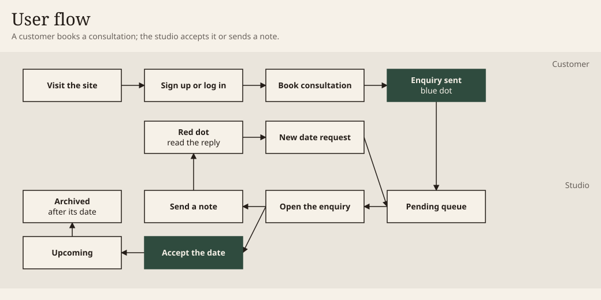
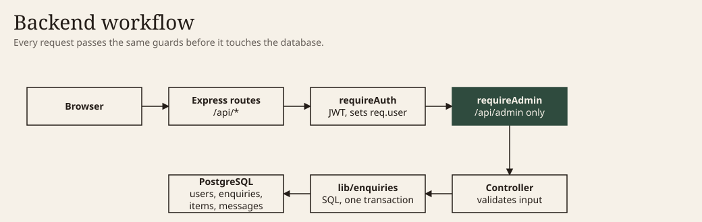
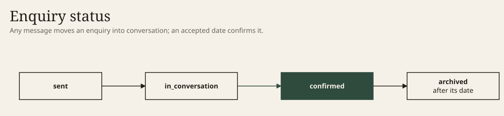

# TailorTrack

A booking and order-tracking platform for a single tailoring studio. Customers
sign up, book a consultation for one or more garments, and follow every reply
from the studio in one place. The studio reviews each request on a single
admin dashboard, accepts the requested date or sends a note, and tracks
upcoming and past consultations and repeat customers.

Pricing is per gauge and is agreed by phone or at the consultation, so the web
app stores no prices and does no accounting.

The original requirement proposal and design notes are in [`docs/`](docs/).

## Live links

| What | Address |
| --- | --- |
| Customer site | https://tailortrackoboyob.vercel.app |
| Studio login | https://tailortrackoboyob.vercel.app/admin/login |
| Backend API | https://tailortrackoboyob-api.onrender.com/api |
| Backend health check | https://tailortrackoboyob-api.onrender.com/health |

The live backend runs on a free plan, so the first request after a pause can
take up to a minute.

## Diagrams

| Diagram | What it shows |
| --- | --- |
| [User flow](docs/diagrams/user-flow.svg) | How a customer and the studio move through a consultation |
| [Backend workflow](docs/diagrams/backend-workflow.svg) | The path every API request takes before it reaches the database |
| [Enquiry status](docs/diagrams/enquiry-status.svg) | The states an enquiry moves through |

Each diagram has an HTML source beside it (`*.html`). The SVG is the same
artwork as a standalone file.

## User flow



**Customer**

1. Visits the site and signs up (first name, last name, phone, email, password, confirmed password) or logs in.
2. Chooses **Book consultation**. The form asks for a preferred date and time, the height, weight and age (pre-filled from the profile), and one or more garments. Each garment has a type (shirt, pant, pajama or suit), a fabric type and a fabric colour, chosen from dropdowns.
3. Sends the enquiry. It appears under **My inquiries** with a blue dot while the studio has not replied.
4. Opens the enquiry to see its status, the garments, the requested date and the conversation. A red dot appears when the studio replies.
5. Asks for a different date with **Ask for a different date**. The request goes back into the studio's queue.

**Studio**

1. Signs in at `/admin/login` with the studio account.
2. Works through the **Pending consultations** queue, which holds new enquiries and those in conversation.
3. Opens an enquiry and either **accepts the requested date** (the enquiry becomes confirmed and the customer sees the date) or **sends a note** (the enquiry moves to conversation and the customer sees a red dot).
4. Reviews **Upcoming consultations**, **Archived consultations** (confirmed, past their date), **Customers** (with the count of consultations, and a *repeat* tag from two onwards) and the two trend charts for garments and fabrics.

A device can hold a customer session and the studio session at the same time.
Each has its own token, so signing in as the studio does not sign the customer
out, and the other way round.

## Backend workflow



Every request goes through the same steps:

1. **Express routes** match the path. Customer routes live under `/api`, studio routes under `/api/admin`.
2. **`requireAuth`** reads the `Authorization: Bearer` token, verifies the JWT and sets `req.user` (`id` and `role`). Signup and login skip this step.
3. **`requireAdmin`** runs only on `/api/admin`. It rejects any token whose role is not `admin`.
4. **The controller** validates the input: item lists, garment and fabric values, measurement ranges, dates, message kinds. A customer cannot create an enquiry from a studio account (403), and a customer can only see or change their own enquiries (404 for anyone else's).
5. **`lib/enquiries`** runs the SQL in a transaction, so an enquiry, its items and its first message are saved together or not at all.
6. **PostgreSQL** stores the data in four tables: `users`, `enquiries`, `enquiry_items` and `enquiry_messages`.

### Enquiry status



- `sent`: the enquiry is in, with no reply from either side.
- `in_conversation`: any message (a note from the studio, or a request from the customer) moves the enquiry here.
- `confirmed`: the studio accepted the requested date. The consultation time is stored and a confirmation message is written.
- **archived** is not stored. A confirmed enquiry counts as archived once its consultation time has passed, so the archive updates on its own.

### Routes

| Method | Path | Who | Purpose |
| --- | --- | --- | --- |
| POST | `/api/auth/signup` | anyone | Create a customer account |
| POST | `/api/auth/login` | anyone | Log in (returns a token and the role) |
| GET, PATCH | `/api/me/profile` | customer | Read or update height, weight and age |
| POST | `/api/enquiries` | customer | Create an enquiry with its items and measurements |
| GET | `/api/enquiries` | customer | List own enquiries, with garments, requested date and unread flag |
| GET | `/api/enquiries/:id` | customer | Own enquiry with items and messages |
| POST | `/api/enquiries/:id/seen` | customer | Mark the studio's replies as read |
| POST | `/api/enquiries/:id/messages` | customer | Send a message or a date request |
| POST | `/api/enquiries/:id/confirm` | customer | Confirm a consultation date |
| POST | `/api/admin/login` | studio | Log in as the studio |
| GET | `/api/admin/customers` | studio | Customers, with consultation counts |
| GET | `/api/admin/enquiries?status=` | studio | `sent`, `in_conversation`, `confirmed` (upcoming) or `archived` |
| GET | `/api/admin/enquiries/:id` | studio | Any enquiry with items and messages |
| POST | `/api/admin/enquiries/:id/messages` | studio | Send a note |
| POST | `/api/admin/enquiries/:id/confirm` | studio | Accept a date |
| GET | `/api/admin/stats` | studio | Counts by garment, fabric and status |
| GET | `/health`, `/health/db` | anyone | API and database checks |

## Project structure

```
frontend/   React app (Vite) — src/app, src/pages, src/components, src/api
backend/    Express API — routes, controllers, lib, middlewares, db, tests
docs/       Requirements, design notes and diagrams
```

## Stack

- **Frontend:** React (Vite) with plain CSS and Vitest
- **Backend:** Express with raw SQL through `pg` (no ORM), `node:test` and supertest
- **Database:** PostgreSQL (Docker locally, Neon or Supabase in production)
- **Deploy:** Vercel (frontend) and Render (backend)

See [`CLAUDE.md`](CLAUDE.md) for why this stack was chosen and how the work is organised.

## Installation

These steps work on Windows, macOS and Linux. Run the commands in a terminal
(PowerShell on Windows, Terminal on macOS and Linux).

### Requirements

- **Node.js 24** (the version CI uses). Check with `node -v`.
- **Git**, to clone the repository.
- **Docker** (Docker Desktop on Windows and macOS), to run the local PostgreSQL database.

### 1. Clone and install

```bash
git clone https://github.com/Disa44ay/Tailor_TracK.git
cd Tailor_TracK
npm install
```

`npm install` at the root installs the `frontend` and `backend` packages together.

### 2. Create the environment files

Copy the two example files. The defaults already match the local database.

Windows (PowerShell):

```powershell
Copy-Item backend\.env.example backend\.env
Copy-Item frontend\.env.example frontend\.env
```

macOS and Linux:

```bash
cp backend/.env.example backend/.env
cp frontend/.env.example frontend/.env
```

In `backend/.env`, set:

- `JWT_SECRET` to any long random string.
- `ADMIN_EMAIL` and `ADMIN_PASSWORD` to the studio account you want to use locally.

`frontend/.env` needs only `VITE_API_URL=http://localhost:3001/api`, which is already the default.

### 3. Start the database

```bash
npm run db:up
```

This starts PostgreSQL 16 in Docker on port 5432.

### 4. Create the tables and the studio account

```bash
npm run db:migrate --workspace=backend
npm run db:seed:admin --workspace=backend
```

The migration can be run again safely. The seed step creates the studio account
from `ADMIN_*` in `backend/.env`.

### 5. Create the test database (once)

The backend tests use a separate database so they never touch your data.

```bash
docker compose exec db psql -U tailortrack -d tailortrack -c "CREATE DATABASE tailortrack_test"
```

The tests clear that database every time they run, so don't use it for data you want to keep.

### 6. Run the app

```bash
npm run dev
```

| What | Address |
| --- | --- |
| Customer site | http://localhost:5173 |
| Studio login | http://localhost:5173/admin/login |
| Backend API | http://localhost:3001/api |
| Backend health check | http://localhost:3001/health |

Sign up as a customer on the site, or sign in as the studio with the
`ADMIN_EMAIL` and `ADMIN_PASSWORD` values from `backend/.env`.

### 7. Run the tests and checks

```bash
npm test --workspace=backend          # backend tests (uses tailortrack_test)
npm test --workspace=frontend         # frontend tests
npm run lint --workspace=frontend     # frontend lint
npx oxlint backend --ignore-pattern node_modules   # backend lint
npm run build --workspace=frontend    # production build
```

### Stopping

Press `Ctrl+C` in the terminal running `npm run dev`. To stop the database,
run `npm run db:down`.

### Troubleshooting

- **Port already in use:** another app is using 3001 or 5173. Stop it, or change `PORT` in `backend/.env`.
- **Database connection refused:** check that Docker is running, then `npm run db:up` again.
- **Frontend shows network errors:** check that the backend is running at `http://localhost:3001/health`, and that `VITE_API_URL` in `frontend/.env` ends in `/api`. Restart `npm run dev` after changing an env file.
- **Studio login fails:** the account exists only after step 4. Check `ADMIN_EMAIL` and `ADMIN_PASSWORD`, then run the seed again.

## Continuous integration

`.github/workflows/ci.yml` runs on pushes to `main`, `Dev_exp` and `dev`, and
on pull requests.

- **Backend job:** lints the backend, migrates a Postgres 16 service and runs the backend tests.
- **Frontend job:** lints the frontend, runs the frontend tests and builds.

A change is only ready to merge when both jobs pass.

## Installing the diagram skill (Claude Code)

The diagrams in `docs/diagrams` were made with the `diagram-design` skill. To
install it globally on this machine:

1. Put the skill's files in a folder on the E: drive, for example `E:\Ghorar Dim\claude-skills\diagram-design`.
2. Make a directory junction from Claude Code's skills folder to that folder, so Claude Code finds the skill:

```powershell
New-Item -ItemType Junction -Path "$env:USERPROFILE\.claude\skills\diagram-design" -Target "E:\Ghorar Dim\claude-skills\diagram-design"
```

3. Start a new Claude Code session. The skill then appears in the skill list
   as `diagram-design`.

The junction keeps the files on E:, as CLAUDE.md requires.

## Git workflow

`main` stays clean and deployable at all times. All work happens on a
`dev`/`feature` branch; it only merges into `main` once it's been shown
and explicitly approved. See [`CLAUDE.md`](CLAUDE.md) for the full rule.
